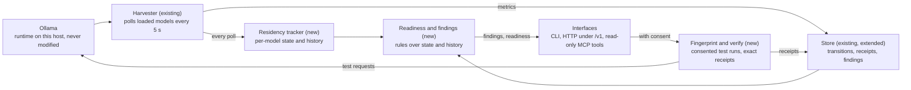

# Wicklee Phase 1: Implementation Specification

2026-11-12 · Jeff Geiser

Phase 1 delivers `wicklee inspect` on one Ollama host, built on the existing Rust agent. This spec is written for Claude Code and follows the v3.2 strategy brief.

## Goal and scope

Phase 1 answers three questions on one Ollama host, from the CLI, HTTP and MCP:

1. What is happening with my local inference?
2. Which models can run safely right now?
3. What could I change, and how do I verify the improvement?

The test of success is a person running local models who says "I didn't know that, and now I can do something about it." Building the primitives is not the goal.

**In scope**

- Passive model-state tracking on one Ollama host, using the existing agent.
- Readiness for every installed model.
- A small set of diagnostic rules, each with an evidence label.
- Consented fingerprint tests that produce exact receipts.
- Finding IDs and a `verify` command that compares before and after.
- A minimal reference agent that changes a decision because of readiness, with a benchmark harness.
- Removal of code Phase 1 replaces.

**Out of scope**

Coordinator, automatic routing, production scheduling, fleet capacity forecasting, Quote and calibration, automatic preparation, enterprise packaging, dashboard work, vLLM and llama.cpp support for the new features.

**Constraints**

- No new crate dependencies. The agent already has axum, tokio, serde, reqwest and DuckDB.
- Existing agent behaviour stays the same unless this spec changes it.
- `inspect` and readiness send no inference requests. Only `fingerprint` and `verify` do, and only with consent.
- No prompt or response text is read or stored anywhere.
- Runtime capabilities are detected from real responses. Nothing is assumed from a version number.

## What exists today

The agent is at version 0.12.0, about 15,250 lines of Rust in `agent/src`. Most of what Phase 1 needs to observe is already collected.

| Module | Lines | Does today | Phase 1 |
| --- | --- | --- | --- |
| `harvester.rs` | 1,457 | Polls `/api/ps` every 5 s, calls `/api/show` on model change, runs the throughput probe | **Extend:** forward each poll to the tracker; track expiry per model; tag probe-caused resets per model |
| `store.rs` | 2,031 | DuckDB store: metrics tiers, traces, events, switch and baseline queries | **Extend:** three tables; widen the trace row |
| `proxy.rs` | 404 | Optional proxy; writes a trace from each final response packet | **Extend:** also capture load time and prompt token counts; emit receipts |
| `observations.rs` | 1,846 | Hardware pattern engine over the store | **Reuse** through an adapter. No new hardware rules |
| `mcp.rs` | 863 | MCP over HTTP and stdio, six tools | **Extend:** three tools. Retire two |
| `main.rs`, `http_api.rs` | 1,827 | Flag handling, routes, handlers | **Extend:** subcommand dispatch, `/v1` routes |
| `metrics.rs`, `hardware.rs`, `samplers.rs` | 2,516 | Payload types, memory, thermal and GPU sensors | **Reuse** unchanged for headroom and pressure |
| `scoring.rs` | 299 | Memory overhead estimate, mirrored with the cloud | **Reuse** for footprint estimates of never-loaded models |
| `runtime_config.rs` | 337 | Captures `/api/show` output per model | **Reuse** to read configured parameters |
| `supervisor.rs` | 170 | Restarts crashed background loops | **Reuse** for the tracker task |
| `model_fit.rs` | 422 | Hugging Face catalog fetch and fit scoring | Not used. Removal candidate |
| `cloud_push.rs`, `pairing.rs` | 355 | Fleet pairing and telemetry push | Frozen |

### Gaps found in the code

These matter for Phase 1 and should be fixed as part of it:

- **Running context is not read.** `ollama_context_length` comes from `/api/show` and is the model's maximum. The `context_length` that `/api/ps` reports for a running model is never parsed.
- **Expiry is tracked for one model.** Keep-alive resets are read from the first loaded model only, and the probe-reset flag is a single boolean.
- **Traces are incomplete.** The proxy records total, prompt-eval and eval durations and the output token count. It drops load time and prompt token counts.
- **Model switches are approximate.** `query_model_switches` derives them from the primary-model column of the metrics table, not from true residency.
- **The probe touches residency.** It is a 20-token generation on already-loaded models, every 10 minutes by default, and it resets the keep-alive timer. The code already skips unloaded models and sends no `keep_alive` value.
- **No store on musl builds.** DuckDB is excluded there, so history must also work from memory.
- **The CLI has flags only.** There are no subcommands. `--status` already works as a client of the running agent, which is the pattern to copy.

### New modules

| Module | Purpose |
| --- | --- |
| `ollama_client.rs` | Typed requests and responses for the Ollama endpoints Phase 1 uses |
| `caps.rs` | Records which response fields this runtime really returns |
| `residency.rs` | Per-model state and a transition log |
| `readiness.rs` | Pure classification of what can run now |
| `findings.rs` | Finding types, evidence checks, IDs, and the rules |
| `receipts.rs` | Receipt type and storage |
| `fingerprint.rs` | Consented test runs and `verify` |
| `cli.rs` | Subcommand dispatch and text rendering |

## Ollama capabilities

The current Ollama documentation confirms the fields below. Documented does not mean present on a given install, so `caps.rs` records which fields appear in real responses and every rule checks it.

### Confirmed by the documentation

| Endpoint | Fields | Used for |
| --- | --- | --- |
| `GET /api/ps`, per running model | `name`, `model`, `size` (bytes), `digest`, `details`, `expires_at`, `size_vram` (bytes), `context_length` | Residency, placement, running context, expiry |
| `POST /api/generate`, final response | `total_duration`, `load_duration`, `prompt_eval_count`, `prompt_eval_cached_count`, `prompt_eval_duration`, `eval_count`, `eval_duration`, `done_reason`. Durations are in nanoseconds | Receipts |
| `POST /api/generate` with only `model` | Loads the model with no prompt | Fingerprint cold-load test |
| `POST /api/generate` with `keep_alive: 0` | Unloads the model | Fingerprint cold-load test |
| `POST /api/show` | `parameters` (text), `model_info`, `capabilities`, `details` | Configured parameters |

The sub-fields of `details` and the keys of `model_info` appear only in examples. Treat them as optional.

### Not documented, verify on a real host first

Step 0 of the plan answers these and records the results in `docs/ollama-capabilities.md`. No rule ships on an unverified assumption.

| # | Question | Why it matters |
| --- | --- | --- |
| V1 | Does `size` minus `size_vram` equal the part of the model outside accelerator memory, on NVIDIA and on Apple Silicon? | The partial-CPU rule depends on it |
| V2 | Does this install return `context_length` in `/api/ps`? | Older versions may not. Without it, context changes are invisible |
| V3 | If a model is loaded with a non-default context, does a request that omits `num_ctx` reload it at the default? | If yes, the existing probe and any test request can themselves cause a reload. Tests must then pass the running `context_length` |
| V4 | Which model does Ollama unload when memory is short, and what limits how many stay loaded? | Decides when an eviction victim can be named |
| V5 | Does `expires_at` move on every request, per model, and how closely does unload time follow it? | Separates keep-alive expiry from eviction |
| V6 | Is there any signal that a prompt was cut to fit the context? | The documented API has none. The truncation rule stays experimental until one is found |
| V7 | What does `GET /api/tags` return per installed model? | Needed to list models that are not loaded. Not checked for this spec |
| V8 | The agent binds to 127.0.0.1 by default and can be set to 0.0.0.0. Do the POST routes check the peer address? | Disruptive endpoints must be reachable from the local machine only |
| V9 | Can the agent find a model's file on disk and tell whether it is in the page cache? | Needed to label a cold start as cached or uncached |

### Capability record

```rust
/// Set from real responses, never from a version string.
pub(crate) struct RuntimeCaps {
    pub version: Option<String>,          // informational only
    pub ps_size_vram: bool,
    pub ps_context_length: bool,
    pub ps_expires_at: bool,
    pub ps_digest: bool,
    pub gen_load_duration: bool,
    pub gen_prompt_eval_count: bool,
    pub gen_prompt_eval_cached_count: bool,
    pub tags_available: bool,
}
```

A rule that needs a missing capability does not run. `inspect` lists what it could not check and why.

## Architecture

Phase 1 adds a tracker, a rules layer and a test runner to the existing agent. It adds no new polling and no new process.



The harvester already polls Ollama every 5 seconds. It now hands each poll to the tracker, which keeps per-model state and writes transitions to the store. Readiness and the rules are pure functions over that state and history. Fingerprint and verify are the only parts that send requests to Ollama, and they run only when an operator asks.

Requirements:

- **One poller.** The tracker consumes the harvester's poll through a channel. It never calls `/api/ps` on its own schedule.
- **Pure core.** `readiness.rs` and the rules in `findings.rs` take state, history and receipts as arguments and return values. They do no I/O, so they are tested without a runtime.
- **Supervised.** The tracker task runs under `supervisor.rs` like the other background loops.
- **One code path.** CLI, HTTP and MCP call the same functions and return the same JSON.

* **Controller-neutral.** Wicklee publishes evidence-based state, constraints and findings. It gives advice about inference conditions, such as "a longer keep-alive may reduce repeated loading." It does not issue instructions over infrastructure, such as "route requests to node B." Agents, schedulers and infrastructure controllers decide and act. Any translation into another system's schema lives in that system or in a separate adapter, never in Wicklee's core types.

## Data structures

These are the Phase 1 types. Field names are proposals; the shapes and the invariants are the requirement.

```rust
// ---- residency.rs ----
pub(crate) enum Residency { Loaded, NotLoaded }

pub(crate) struct ModelState {
    pub model: String,
    pub digest: Option<String>,
    pub residency: Residency,
    pub size_bytes: Option<u64>,          // from /api/ps while loaded
    pub size_vram_bytes: Option<u64>,
    pub context_length: Option<u64>,      // running context, from /api/ps
    pub expires_at_ms: Option<i64>,
    pub last_activity_ms: Option<i64>,    // expiry reset or proxy packet, probe excluded
    pub installed_size_bytes: Option<u64>,// from /api/tags
    pub observed_at_ms: i64,
}

pub(crate) enum TransitionKind {
    Loaded, Unloaded, ExpiryReset, PlacementChanged, ContextChanged,
}
pub(crate) enum Cause { User, Probe, Fingerprint, ExpiryReached, Unknown }

pub(crate) struct Transition {
    pub id: u64,
    pub ts_ms: i64,
    pub model: String,
    pub kind: TransitionKind,
    pub cause: Cause,
    pub before: Option<ModelState>,       // boxed in practice
    pub after: Option<ModelState>,
    pub co_resident: Vec<String>,
}

// ---- readiness.rs ----
pub(crate) enum Readiness { ReadyNow, RequiresLoading, MayRequireEviction, CannotDetermine }
pub(crate) enum Displacement { Confirmed, Likely, UnknownVictim }

/// How the footprint was established.
pub(crate) enum FitBasis { Measured, Estimated }
/// Why a specific model can be named. A Victim cannot be built without one.
pub(crate) enum VictimBasis { History { occurrences: u32 }, OnlyLoadedModel }
pub(crate) struct Victim { pub model: String, pub in_use: Option<bool>, pub basis: VictimBasis }

pub(crate) struct ModelReadiness {
    pub model: String,
    pub readiness: Readiness,
    pub displacement: Option<Displacement>, // only with MayRequireEviction
    pub fit_basis: Option<FitBasis>,        // None when fit is unknown
    pub would_displace: Vec<Victim>,        // empty unless evidence names a model
    pub load_time_ms: Option<Range>,        // from observed loads only
    pub statements: Vec<Statement>,
    pub observed_at_ms: i64,
    pub valid_for_s: u32,
}

// ---- findings.rs ----
pub(crate) enum Evidence { Observed, Inferred, Verified }

pub(crate) enum EvidenceRef {
    Transition(u64),
    Sample { metric: &'static str, from_ms: i64, to_ms: i64 },
    Receipt(String),
    VerifyRun(String),
}

pub(crate) struct Statement {
    pub label: Evidence,
    pub text: String,
    pub basis: Vec<EvidenceRef>,          // never empty
}

pub(crate) enum FindingStatus { Open, Resolved, Dismissed }

pub(crate) struct Finding {
    pub id: String,                       // "F-12", stable per (rule, subject) on this host
    pub rule: &'static str,
    pub subject: Vec<String>,             // model names
    pub status: FindingStatus,
    pub statements: Vec<Statement>,
    pub suggestion: Option<String>,
    pub test: Option<TestSpec>,           // what `verify` runs
    pub first_seen_ms: i64,
    pub last_seen_ms: i64,
}

// ---- receipts.rs ----
pub(crate) enum ReceiptSource { Fingerprint, Proxy }
pub(crate) enum StartState { Loaded, ColdCached, ColdUncached, ColdUnknown }

pub(crate) struct Receipt {
    pub id: String,
    pub ts_ms: i64,
    pub source: ReceiptSource,
    pub model: String,
    pub digest: Option<String>,
    pub context_length: Option<u64>,
    pub size_bytes: Option<u64>,
    pub size_vram_bytes: Option<u64>,
    pub start_state: StartState,
    pub load_ns: Option<u64>,
    pub prompt_eval_count: Option<u64>,
    pub prompt_eval_cached_count: Option<u64>,
    pub prompt_eval_ns: Option<u64>,
    pub eval_count: Option<u64>,
    pub eval_ns: Option<u64>,
    pub total_ns: Option<u64>,
    pub wall_ms: Option<u64>,             // measured by Wicklee for its own tests
    pub co_resident: Vec<String>,
    pub thermal_state: Option<String>,
    pub test_id: Option<String>,
    pub finding_id: Option<String>,
}

// ---- fingerprint.rs ----
pub(crate) enum TestKind { DecodeRate, ColdLoad, WorkflowReplay }

pub(crate) struct TestSpec {
    pub kind: TestKind,
    pub models: Vec<String>,
    pub num_ctx: Option<u64>,
    pub runs: u8,                         // default 3
}

pub(crate) struct VerifyRun {
    pub id: String,
    pub finding_id: String,
    pub ts_ms: i64,
    pub config: Vec<ModelState>,          // snapshot when the run started
    pub receipts: Vec<String>,
    pub median: f64,
    pub low: f64,
    pub high: f64,
}
```

### Storage

Three new DuckDB tables: `model_transitions`, `receipts`, `findings` (with `verify_runs` stored alongside). Follow the existing rule in `store.rs` that blocking database calls run off the async thread.

On musl builds there is no DuckDB. The tracker keeps the last 2,000 transitions in memory, and findings and receipts last only until restart. `inspect` says so in its output.

The proxy's `TraceRow` gains `load_duration_ns`, `prompt_eval_count` and `prompt_eval_cached_count`. Each proxied request then also yields a `Receipt` with source `Proxy`.

## Evidence rules

Every statement Wicklee makes carries one label, and the code enforces what each label requires.

| Label | Means | Requires | Wording |
| --- | --- | --- | --- |
| **Observed** | Wicklee saw it | At least one transition, sample or receipt in `basis` | States the fact with counts and times. No cause |
| **Inferred** | A likely cause or effect | An observed statement it builds on | Must use "may" or "likely" |
| **Verified** | Confirmed by measurement | Exact receipts from a fingerprint or verify run | States the measured number and its range |

Enforcement:

1. `Statement` is built only through constructor functions. Each one rejects a `basis` that does not meet its label's requirement.
2. A finding must contain at least one observed statement. A finding with only inferred statements is not shown.
3. A cause is never labelled observed. Unload time alone does not say why a model unloaded.
4. A before-and-after claim is verified only when both runs exist, each has at least three receipts, and their ranges do not overlap. Otherwise the result is "no measurable change."
5. A statement names a specific model as affected only when a transition or receipt in its `basis` names that model.
6. When evidence is missing, the output says what was not checked. It never fills the gap with an estimate.

Unit tests cover each rejection path.

## Readiness rules

Readiness answers "which installed models can run right now without disturbing another active workload?" It is a pure function of current state, memory headroom and the transition log. It assesses operational suitability only. It never says two models are interchangeable.

### Classification

Apply in this order for each installed model:

| Result | Condition |
| --- | --- |
| `ReadyNow` | The model is loaded |
| `CannotDetermine` | Its memory footprint cannot be established, or free accelerator memory is unknown |
| `RequiresLoading` | Not loaded, and its footprint plus a safety margin fits in free memory |
| `MayRequireEviction` | Not loaded, and its footprint does not fit in free memory |

A `ReadyNow` answer also reports pressure and placement, for example "loaded, 38% outside accelerator memory." Loaded does not mean fast.

**Footprint** comes from the best available source, and the answer names which:

1. The `size` last observed in `/api/ps` for the same digest and context length. Labelled observed.
2. The installed file size with the overhead estimate from `scoring.rs`. Labelled inferred.
3. Neither is available: `CannotDetermine`.

### Displacement certainty

`MayRequireEviction` always carries one of three levels. A model is named only when runtime evidence supports it.

| Level | Condition | Names a model |
| --- | --- | --- |
| `Confirmed` | The transition log shows loading this model unloaded the same model every time, at least twice, with the same set of loaded models | Yes, the one in the log |
| `Likely` | The footprint does not fit, and exactly one other model is loaded | Yes, that model |
| `UnknownVictim` | The footprint does not fit, several models are loaded, and history does not settle which one goes | No |

`Confirmed` describes past behaviour on this host. The statement is labelled observed and worded as history: "loading X unloaded Y on 3 of 3 occasions." The prediction itself stays inferred.

### Three kinds of knowledge

Eviction risk is a stronger claim than listing loaded models, and the runtime may decide differently depending on memory, context settings and concurrency. The types keep three things apart:

| Kind | What it covers | In the data model |
| --- | --- | --- |
| Observed | Which models are loaded and the memory they occupy | `ModelState`, from `/api/ps` |
| Estimated | Whether another model fits in free memory | `fit_basis`: `Measured` or `Estimated` |
| Uncertain | Which model, if any, the runtime will unload | `would_displace` stays empty unless a `VictimBasis` exists |

A `Victim` cannot be constructed without a `VictimBasis`, so the code cannot name a model on a guess. Every statement about a future eviction is labelled inferred, whatever its basis. The reference agent demo must work with `UnknownVictim` answers too, so it does not depend on more certainty than the runtime gives.

### In use

A model counts as in use when it had activity in the last 60 seconds. Activity is an `expires_at` reset not caused by Wicklee's probe or tests, or a proxied request when the proxy is on. When neither signal is available, `in_use` is unknown and the answer says so.

### Useful, not just valid

"Requires loading" alone tells a caller little. Each answer therefore adds what the tracker knows: observed load times for that model, what would be displaced, and whether the victim is in use.

```json
{
  "model": "reasoner:14b",
  "readiness": "may_require_eviction",
  "displacement": "likely",
  "would_displace": [{ "model": "coder:14b", "in_use": true }],
  "load_time_ms": { "low": 6200, "high": 9100, "samples": 4 },
  "statements": [
    { "label": "observed", "text": "coder:14b is the only loaded model and had activity 12 s ago." },
    { "label": "inferred", "text": "reasoner:14b needs about 11.2 GB and 3.1 GB is free, so loading it will likely unload coder:14b." }
  ],
  "observed_at_ms": 1794528000000,
  "valid_for_s": 10
}
```

Values are illustrative. `valid_for_s` is two poll intervals.

## Diagnostic rules

Phase 1 ships four rules and one experimental rule. Each must pass the hard test: it says something the runtime's own status command and a short script would not.

| Rule | Trigger | Observed statement | Inferred statement | Verify test | Needs |
| --- | --- | --- | --- | --- | --- |
| `cpu_split` | A loaded model has `size_vram` below `size` for three consecutive polls | Share outside accelerator memory, and since when | The change that preceded it, from the log: a larger context or another model loading | Generation rate now against the suggested configuration | V1, `ps_size_vram` |
| `eviction_churn` | The same two models unloaded each other three or more times in an hour, each unload within 10 s of the other's load and before its expiry | Count, times, and the pair | Memory contention may be causing the reloads | Time for the two-model sequence, before and after the change | V4, V5 |
| `expiry_reload` | A model unloaded at its expiry and was loaded again within 10 minutes, three or more times in a day | Count, gaps between requests, and the keep-alive in effect | The keep-alive may be shorter than the pause between steps | Cold-load time, which is the cost of each reload | V5, `ps_expires_at` |
| `baseline_regression` | Generation rate for a fingerprinted model is more than 20% below its baseline, same digest | Baseline and current rate, with receipts | Configuration differences since the baseline: context, placement, co-loaded models, thermal state | Re-run the fingerprint | A fingerprint baseline |
| `context_limit` (experimental) | Proxied requests whose `prompt_eval_count` is at the running context length | How many requests reached the limit | Early prompt content may have been dropped | None yet | Proxy on, V2, V6 |

Rules that already exist in `observations.rs` (thermal, swap, memory pressure) appear in `inspect` through an adapter that maps each to a finding with observed and inferred statements. Phase 1 writes no new hardware rules.

### What the hard test means for each rule

- **`cpu_split`:** the status command shows the split. It does not show when the split began, what changed at that moment, or what the split costs.
- **`eviction_churn` and `expiry_reload`:** the status command shows only the present. Both rules need history.
- **`baseline_regression`:** needs a stored baseline and a configuration comparison.

### Rule requirements

- Rules are pure functions over the transition log, current state and receipts. They are tested with synthetic logs.
- Transitions caused by Wicklee's probe or tests are excluded from every count.
- A rule whose required capability or verification is missing does not run, and `inspect` lists it under "not checked."
- A healthy host produces no findings. "No significant issues found" is a normal result.
- `context_limit` is off by default. It turns on only after V6 shows a reliable signal, and it never appears in the product's headline examples before then.
- Thresholds above are starting values, defined as named constants in one place.

## Fingerprint and verify

These are the only Phase 1 features that send inference requests. Both need consent on every run.

### Three modes

| Command | Sends requests | Can change what is loaded |
| --- | --- | --- |
| `inspect`, `ready` | No. The existing throughput probe keeps its own schedule and is not triggered | No |
| `fingerprint` | Yes | Yes |
| `verify` | Yes | Yes |

### Consent

Before running, the command prints what it will do: which models it will load, what readiness says would be displaced, and roughly how long it will take. It proceeds on an interactive yes or a `--yes` flag. Over HTTP the request must include `"consent": true`. Fingerprint and verify are not exposed over MCP in Phase 1, so an agent cannot trigger a model load through Wicklee.

A run refuses to start when it would displace a model that is in use, unless the operator passes `--force`.

### Test protocol

- **Prompt:** a fixed synthetic prompt generated by Wicklee at a known token length. No user content.
- **Settings:** fixed output length, temperature zero, fixed seed. The request passes the model's running `context_length` as `num_ctx` so the test does not change the loaded configuration (see V3).
- **Warm test (`DecodeRate`):** three runs on a loaded model. Records prompt-processing rate and generation rate.
- **Cold test (`ColdLoad`), only with `--cold`:** unload the model, load it with no prompt, record `load_duration` and wall time. Three runs.
- **Sequence test (`WorkflowReplay`):** runs a declared sequence of models, for the churn rule. Records total wall time and reloads.
- **Tagging:** every request Wicklee sends is tagged in the tracker with cause `Fingerprint`, so rules ignore it.
- **Restore:** a model that was loaded before the run is loaded again afterwards. Its original expiry cannot be restored, and the output says so.

### Cold-start state

Each cold receipt records one of `ColdCached`, `ColdUncached` or `ColdUnknown`. Phase 1 records `ColdUnknown` unless V9 shows a reliable way to check the page cache. Cold results with different start states are never averaged together.

### Verify

`wicklee verify F-12` runs the test attached to that finding and stores a `VerifyRun` with a snapshot of the configuration.

- The first run is the baseline.
- The operator changes the configuration and runs the same command again.
- Wicklee prints both runs side by side with medians and ranges, and what differed in the configuration.
- The outcome is one of: improved, no measurable change, or worse. It is improved or worse only when the two ranges do not overlap.
- On "improved," the finding gains a verified statement and resolves once its trigger stops firing.

Verify is a workflow over fingerprint and receipts. It adds no separate test engine.

## Interfaces

All three interfaces serve the same data from the same functions. The CLI is a client of the running agent, like the existing `--status` flag.

### CLI

| Command | Purpose |
| --- | --- |
| `wicklee inspect [--since 24h] [--json]` | Findings, readiness, suggested changes |
| `wicklee ready [MODEL] [--json]` | Readiness only |
| `wicklee findings [--all]` | List findings, including resolved ones |
| `wicklee fingerprint [MODEL] [--cold] [--yes]` | Run consented tests and store a baseline |
| `wicklee verify <ID> [--yes]` | Run a finding's test and compare with the previous run |

A first argument that does not start with `--` is a subcommand. Running `wicklee` with no arguments, and every existing flag, behaves as today. If the agent is not running, the command says how to start it.

Text output has three sections that match the three questions. Illustrative:

```
$ wicklee inspect

WHAT IS HAPPENING
  F-12  OBSERVED  coder:14b has had 38% of its memory outside the GPU
                  since 14:02.
        INFERRED  Its context grew from 8K to 32K at 14:02, which
                  likely caused the split.

WHICH MODELS CAN RUN SAFELY NOW
  classifier:3b   Ready now
  extractor:8b    Requires loading, about 4 s (observed, 6 loads)
  reasoner:14b    May require eviction: likely unloads coder:14b,
                  which is in use
  embed:small     Cannot determine: never loaded on this host

WHAT TO CHANGE
  F-12  Test a 16K context:  wicklee verify F-12

Not checked: context_limit (proxy is off)
```

With no findings, the first section reads "No significant issues found" and the readiness section still prints.

### HTTP

New routes live under `/v1`. Existing `/api` routes are unchanged.

| Route | Returns |
| --- | --- |
| `GET /v1/state` | Every installed model with residency, placement, context, expiry, and the capability record |
| `GET /v1/readiness` and `?model=` | Readiness per model |
| `GET /v1/inspect` | Findings, readiness, and the "not checked" list |
| `GET /v1/findings`, `GET /v1/findings/{id}` | Findings with statements and verify runs |
| `GET /v1/receipts?model=` | Receipts |
| `POST /v1/fingerprint` | Runs tests. Body needs `"consent": true` |
| `POST /v1/verify` | Runs a finding's test. Body needs `"consent": true` |

The two `POST` routes accept connections from the local machine only. The agent can be configured to bind to all interfaces, so these routes check the peer address themselves (V8).

### Remote access

Phase 1 adds a startup rule, because the agent reports hardware, loaded models and operating conditions:

| Configuration | Behaviour |
| --- | --- |
| Loopback, no token | Allowed |
| Non-loopback, token configured | Allowed. Requests from other machines to `/v1` and MCP must present the token as a bearer token, compared in constant time |
| Non-loopback, no token | Refuses to start |
| Non-loopback, explicit `allow_unauthenticated` override | Allowed, with a prominent warning printed at every startup |

Today the agent can be bound to all interfaces with no token, so this is a behaviour change and also belongs in the release notes.

A token authenticates the caller and does not encrypt traffic. Remote access should use TLS or a trusted private network.

### MCP

Three read-only tools are added. They return the same JSON as the HTTP routes.

| Tool | Returns | Description to give the agent |
| --- | --- | --- |
| `wicklee_state` | `/v1/state` | What is installed and loaded on this host |
| `wicklee_readiness` | `/v1/readiness` | Call before starting a task to see whether a model can run without displacing another |
| `wicklee_inspect` | `/v1/inspect` | Current findings about slow or unstable inference |

`get_model_fit` and `get_observations` are retired, because readiness and inspect replace them. The other four existing tools stay.

## Reference agent and benchmark harness

Phase 1 includes a small reference integration built in this repository. It shows a controller changing an execution decision because of readiness, with a measured benefit. An integration by an outside developer is an adoption milestone and is not required to validate the build.

Both pieces live in `scripts/bench/` as Node scripts with no dependencies, like the existing scripts. Nothing here ships in the agent binary.

### Demo: the model load that never happened

The scenario uses a real multi-model workflow on one host with constrained accelerator memory.

- **Workflow A** runs continuously and uses one model, which stays loaded and in use.
- **Workflow B** has a step with two execution options that the operator declares acceptable in a scenario file: a preferred model, and an alternative. One option creates an eviction and reload risk for Workflow A. The other does not.

The operator declares which options are acceptable. Wicklee does not judge whether two models are equivalent.

### Policies compared

| Policy | How it chooses for Workflow B |
| --- | --- |
| `naive` | Always the preferred model |
| `loaded_check` | Reads `/api/ps`. Picks an acceptable model that is already loaded, otherwise the preferred model |
| `wicklee` | Reads `/v1/readiness`. Avoids any option that would displace an in-use model, picks the best remaining option, and defers the step when none is safe and the scenario allows it |

`loaded_check` is the meaningful baseline. Wicklee should beat it only in cases it cannot see, mainly when no acceptable option is loaded and one choice would displace the in-use model while another would fit beside it. The scenario set must also include cases where the two policies tie, and they are reported.

### Measurements

For each policy, at least five runs in randomised order:

- End-to-end time for Workflow B.
- Added latency and reload count for Workflow A.
- Total model reloads on the host, from the transition log.
- Number of times an in-use model was displaced.

The harness writes raw results as JSON and a summary table as Markdown, with medians and ranges. It records hardware, models, quantization, Ollama version and Wicklee version.

### Fault injection

The same harness creates known conditions for the diagnostic tests. Model names and sizes come from a scenario file the operator fills in for their hardware.

| Scenario | How it is induced | Expected result |
| --- | --- | --- |
| Partial CPU placement | Load a model with a context too large to fit in accelerator memory | `cpu_split` fires, naming the context change |
| Eviction churn | Alternate requests between two models that cannot both stay loaded | `eviction_churn` fires for that pair |
| Expiry reloads | Use a short keep-alive with longer pauses between requests | `expiry_reload` fires |
| Regression | Fingerprint, then repeat with a larger context | `baseline_regression` fires and lists the context change |
| Healthy control | One small model, steady requests, ample memory | No findings |

## Acceptance tests

Phase 1 is done when both demonstrations below pass and the automated tests are green.

### Automated

- **Unit:** readiness classification for every branch, including all three displacement levels. Each rule against synthetic transition logs, with positive and negative cases. Every rejection path of the evidence constructors.
- **Integration:** a mock Ollama server, compiled only for tests, replays scripted `/api/ps` sequences. Tests assert the transitions recorded, the findings raised, and the JSON returned by each `/v1` route.
- **Capability gaps:** the mock omits `size_vram`, `context_length` and `expires_at` in turn. Each dependent rule must switch off and appear under "not checked."
- **No side effects:** during `inspect` and `ready`, the mock receives no generate requests from those commands.
- **Existing tests** keep passing, and CI stays at zero warnings.

### Human value

| Test | Passes when |
| --- | --- |
| Detection | Each fault-injection scenario raises its expected finding with correct statements |
| Quiet on healthy systems | The healthy control raises no findings across 24 hours of normal use |
| Reproducible | A finding's test gives overlapping ranges when run twice with no change |
| Fix confirmed | For at least one injected fault, applying the suggested change gives "improved" from `verify` |
| Other hardware | The above pass on the maintainer's machines and at least three outside machines with different configurations |
| Hard test | Each finding states something the runtime's status command and a short script would not |

How often real users learn something new is tracked separately. It is not a pass condition.

### Agent value

| Test | Passes when |
| --- | --- |
| Decision changed | In the demo scenario, the `wicklee` policy chooses differently from `loaded_check` in at least one case |
| Measured benefit | In those cases, Workflow A sees fewer reloads and less added latency, with ranges that do not overlap |
| No harm | Where the policies choose the same option, results match within run-to-run noise |
| Honest answers | Every eviction answer in the run that named a model was right about which model unloaded |

A `wicklee` policy that only ties `loaded_check` everywhere is a valid and important result. It would mean readiness adds little beyond a loaded-model check on that hardware, and the write-up must say so.

### Overhead

Measure agent CPU and memory with Phase 1 running against the 0.12.0 baseline, and inference throughput with and without the agent. Report the numbers. The tracker adds no new polling, so the expected difference is small.

## Cleanup plan

Phase 1 is a large change, so removal is part of the work. The repository holds about 69,000 lines of code today: 15,250 in the agent, 13,400 in the cloud backend and 40,100 in the frontend.

### Rules

1. **Audit before deleting.** Step 0 produces `docs/CLEANUP_AUDIT.md`. For each candidate it lists the callers, the routes the frontend still uses, and the cloud consumers. Nothing is deleted on a guess.
2. **One system per job.** When new code replaces old code, the old code goes in the same step. No parallel engines and no compatibility aliases.
3. **Removal is its own commit.** Each one compiles, passes tests, and can be reverted alone.
4. **No new dependencies,** and no new background polling loops.
5. **Measure it.** Record agent line count and release binary size before Phase 1 and after each step. Report both in the final write-up.
6. **Target:** Phase 1 adds no more than about 3,500 lines to `agent/src`, tests excluded, after removals. This is an estimate to manage against, not a measured figure.

### Remove during Phase 1

These are replaced by Phase 1 work or are stale documents.

| Item | Size | Why | When |
| --- | --- | --- | --- |
| MCP tools `get_model_fit` and `get_observations` | Part of `mcp.rs` | Replaced by `wicklee_readiness` and `wicklee_inspect` | With the MCP step |
| Switch detection in `query_model_switches` | Part of `store.rs` | Replaced by the transition log. The route stays and reads the new table | With the tracker step |
| Single-model expiry and probe-reset flags in `OllamaMetrics` | Part of `metrics.rs`, `harvester.rs` | Replaced by per-model tracking | With the tracker step |
| Raw JSON parsing of `/api/ps` in the harvester | Part of `harvester.rs` | Replaced by `ollama_client.rs` types | With the client step |
| `docs/GTM.md`, `docs/NEXT_STEPS.md`, `docs/CODE_REVIEW.md` | 289 lines | Describe a strategy the v3.2 brief replaced | Step 0 |
| `docs/progress.md` | 2,718 lines | A journal. Git history holds the same record | Step 0 |
| `docs/ROADMAP.md` | 481 lines | Rewrite to match v3.2. Do not delete | Final step |

Also remove `routing_hint` from the observation engine in step 4. It issues instructions such as "steer away" with no evidence and no workload context, which the findings model replaces. The audit must first list what reads it, including the cloud push and any outside consumer.

### Freeze, do not touch

These stay as they are and are excluded from Phase 1 builds of new features. The hosted site and checkout are live, so removing them is a product decision.

- `cloud/` (13,400 lines) and `src/cloud/` (6,900 lines): the hosted fleet backend and views.
- `src/site/` (5,600 lines): the marketing and docs site.
- `cloud_push.rs` and `pairing.rs` in the agent.
- vLLM and llama.cpp harvesting. Phase 5 needs it.

### Decisions on the larger removals

The maintainer decided the first three on 2026-11-12. The Question column records each decision or what is still open.

| Candidate | Size | What depends on it | Question |
| --- | --- | --- | --- |
| Model discovery: `model_fit.rs`, the catalog table, `/api/model-candidates` | About 420 agent lines plus cloud and frontend parts | Dashboard card, fleet view, the demo, the docs page, the cloud catalog | Decided: remove everywhere, including the dashboard card, fleet view, demo and docs page. |
| Embedded dashboard | About 18,000 lines of components, compiled into the agent binary | Every `/api` route the UI calls | Decided: remove it from the agent binary and serve a minimal debugging page instead. |
| Dashboard-only agent routes: cost by model, SLA, profile, export, model comparison | Parts of `http_api.rs` and `store.rs` | Used by two to five frontend files each | Decided: remove with the dashboard, once the audit confirms nothing else calls them |
| Cloud features: alerts, governance, SLO, reports, webhooks, billing | About 4,800 cloud lines | Paid tiers and the live checkout | Decided: paid tiers are withdrawn until there is a monetization plan. The code stays frozen for now. The maintainer is open to deleting it later |
| Enterprise docs: `SSO.md`, `MODEL_GOVERNANCE.md`, `TERRAFORM.md`, `SELF_HOSTING.md`, `BILLING.md` | 637 lines | The current pricing page | Follow the cloud code decision above |
| WES leaderboard charter | 168 lines | The measurement-lab idea | Keep if that idea continues |

Order of work for these removals:

1. **Model discovery:** remove in step 0. Nothing in Phase 1 depends on it.
2. **Paid tiers:** take down the pricing page and turn checkout off first. Confirm there are no active subscriptions, and cancel and refund any that exist, before removing anything they pay for.
3. **Embedded dashboard:** remove after step 4, when `wicklee inspect` and the `/v1` routes exist to replace it. The debugging page shows State, findings with their evidence, and receipts.
4. **Dashboard-only agent routes:** remove with the dashboard.

The dashboard components are shared with the hosted fleet view on wicklee.dev. Removing the embedded dashboard takes them out of the agent binary. They stay in the repository for the hosted fleet view, which remains frozen. The maintainer is open to removing it later.

## Implementation plan

Steps are in dependency order. Each step ends with its tests passing and a short note of what was verified.

| Step | Build | Depends on | Done when |
| --- | --- | --- | --- |
| 0 | Verification and audit. A script in `scripts/bench/` records real Ollama responses and answers V1 to V9. Write `docs/ollama-capabilities.md` and `docs/CLEANUP_AUDIT.md`. Record baseline line count and binary size. Remove the stale documents | Nothing | Every V item has an answer or is marked unanswerable, with the affected rule adjusted |
| 1 | `ollama_client.rs` and `caps.rs`. Typed responses with every field optional. The harvester uses them | 0 | Existing harvester tests pass. Capability record is correct against the mock with fields removed |
| 2 | `residency.rs` and the `model_transitions` table. The harvester forwards each poll. Per-model expiry and activity. Probe and test requests tagged by cause. In-memory log for musl | 1 | Scripted poll sequences produce the expected transitions. `query_model_switches` reads the new table |
| 3 | `readiness.rs`, `GET /v1/state`, `GET /v1/readiness`, `cli.rs` with `wicklee ready` | 2 | Unit tests cover every classification branch and displacement level |
| 4 | `findings.rs`: types, evidence constructors, IDs, the `findings` table. Rules `cpu_split`, `eviction_churn`, `expiry_reload`. The observations adapter. `GET /v1/inspect`, `wicklee inspect`, `wicklee findings` | 2, 3 | Each rule passes positive and negative synthetic cases. A healthy log yields no findings |
| 5 | `receipts.rs` and the `receipts` table. Widen the proxy trace and emit proxy receipts. `fingerprint.rs` with warm and cold tests, consent, restore. `wicklee fingerprint` | 1, 2 | Receipts match the mock's timings. Refuses without consent. Tracker shows test requests tagged |
| 6 | Verify runs and comparison. `wicklee verify`. Rule `baseline_regression`. Verified statements | 4, 5 | Two runs with a changed mock configuration report "improved." Unchanged runs report "no measurable change" |
| 7 | MCP: add three tools, retire two | 3, 4 | Tool output equals the HTTP JSON |
| 8 | Fault-injection scenarios and the reference controller with three policies in `scripts/bench/` | 3, 4, 6 | Each scenario runs end to end on the maintainer's host |
| 9 | Acceptance runs on the maintainer's machines, then three outside machines. Overhead measurement | 8 | Both demonstrations pass, or the write-up states plainly what did not |
| 10 | Update the README and `docs/ROADMAP.md`. Publish results with method and raw data | 9 | A new user can install, run `wicklee inspect`, and understand the output from the README alone |

The remote-access rule is built in step 3, before the first `/v1` route ships.

### Notes for the implementer

- Read `harvester.rs`, `store.rs` and `main.rs` fully before step 1. The harvester's probe logic and the store's threading rule both constrain the design.
- Steps 3 and 4 give a usable product without any test requests. If time runs short, ship after step 4 and continue.
- If step 0 shows a rule's assumption is false, change or drop the rule and record why. Do not ship a rule that guesses.
- The `context_limit` rule is built only if V6 finds a reliable signal.
- Keep the `inspect` text output close to the example in this spec. That output is the product's first impression.

## Sources

Ollama fields in this spec were checked against the current documentation on 2026-11-12. Agent details were read from the repository at commit `d708ffa`.

- [Ollama: list running models](https://docs.ollama.com/api/ps.md)
- [Ollama: generate a response](https://docs.ollama.com/api/generate.md)
- [Ollama: show model details](https://docs.ollama.com/api-reference/show-model-details.md)
- [Wicklee v3.2: Product Strategy and Technical Validation Plan](https://claude.ai/artifact/QbFobB6CLkXPnBXh3Gt7cJ)
